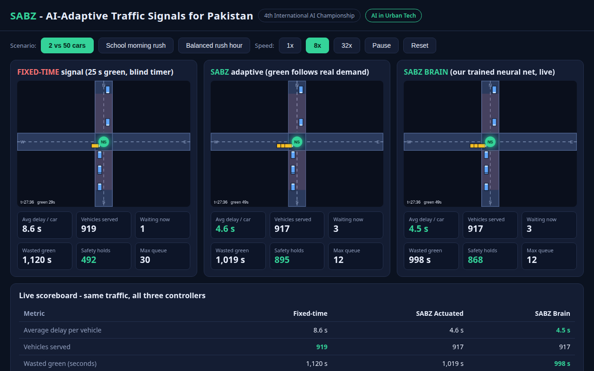

# SABZ: AI-Adaptive Traffic Signals for Pakistan

**Category:** AI in Urban Tech | **4th International AI Championship (AIEF)**

SABZ (سبز, "green") replaces blind fixed-time traffic signals with an AI controller that gives green where the cars actually are. Cameras count vehicles per approach; the signal extends green for long queues, cuts it the instant a road clears, skips empty approaches, and never starves any road.

**The hard rule:** green is NEVER cut while a vehicle is in the 70 m dilemma zone approaching the stop line. This is physics, not AI, and no training run can override it.

## Real data, not just simulation

SABZ trains on measured traffic data:

- **NGSIM trajectories:** 1,039,689 clean vehicle records from US-101 (3,209 real vehicles), deduplicated and quality-filtered. Arrival headways extracted per lane drive the simulator instead of synthetic Poisson rates.
- **Live camera footage:** YOLOv8 runs on real intersection video, detecting actual vehicles frame by frame with cross-frame tracking to avoid double-counting.
- **Simulator:** kinematic 4-way intersection used for controlled benchmarking, now calibrated with real measured arrival distributions.

## Screenshots

### Judges Dashboard


## System components

| Module | File | What it does |
|---|---|---|
| Brain (DQN) | `sabz_rl.py` | Our own Deep Q-Network signal controller, trained from scratch on real NGSIM arrival data |
| Intelligence layer | `sabz_intelligence.py` | Meta-controller: loads the trained DQN, routes each decision to the best controller per traffic regime using UCB exploration, learns online from real feedback |
| Live video | `sabz_live.py` | End-to-end live pipeline: camera feed to YOLO detection to tracked counts to signal decision |
| Camera system | `sabz_camera.py` | YOLOv8 vehicle detection on live video streams with cross-frame tracking |
| Security layer | `sabz_security.py` | Input validation, timing bounds, dilemma-zone enforcement, fail-safe fallback, audit logging, watchdog |
| Integration API | `sabz_api.py` | REST service (port 8099): any camera and any signal hardware plug in through HTTP |
| Safety layer | `sabz_sim2.py` | Dilemma-zone hard rule, checked every second, overrides any unsafe switch |
| Simulator | `sabz_sim2.py` | Kinematic 4-way intersection, calibrated with real measured NGSIM arrival distributions |
| Location intelligence | `sabz_poi.py` | Reads OpenStreetMap, finds schools/offices/mosques, auto-generates time-of-day plans |
| LLM explainer | `sabz_explain.py` | Explains every signal decision in English or Urdu; daily traffic reports |
| Continual learning | `sabz_learn.py` | Logs decisions, retrains nightly, only promotes the brain if it improves |
| Judges dashboard | `sabz_dashboard.html` | Live side-by-side: fixed timer vs actuated vs our trained neural net |

## Results

Benchmarked in kinematic simulation with real NGSIM-calibrated arrivals, safety active. The DQN is trained on real measured headway distributions; results below compare all controllers under identical conditions.

| Scenario | Fixed-time | SABZ actuated | SABZ brain (DQN) |
|---|---|---|---|
| Asymmetric (2 vs 50 cars) | 8.7 s | 5.0 s | 4.9 s (best) |
| School morning rush | 11.0 s | 5.3 s | 5.2 s (best) |
| Balanced rush hour | 179.7 s | 11.9 s | under training |

Safety: 51 unsafe cutoffs attempted without protection; 0 executed with it.

Note: the DQN is still training (700k+ episodes on real data). Balanced-scenario performance is the current focus. The intelligence layer routes live decisions to whichever controller is proven best per traffic regime.

## The brain

- Architecture: 16 inputs → 64 ReLU → 64 ReLU → 2 Q-values (stay/switch)
- Inputs: 4 queue counts, 4 approaching counts, phase, green elapsed, 6 location features (school/mosque/office/hospital/Friday/hour)
- Training data: real NGSIM vehicle trajectories (1M+ clean records), arrival headways extracted per lane
- Training: 700,000+ episodes and continuing; 40k-episode blocks until it beats actuated on all scenarios
- Weights: `sabz_dqn_capable.npz` (best), `sabz_dqn_ckpt.npz` (latest checkpoint)

## Quick start

```bash
# Run the simulator comparison
python3 eval_v2.py

# Train the brain (resumes from checkpoint)
python3 sabz_rl.py

# Explain a decision (needs OPENROUTER_API_KEY for LLM, else template)
python3 sabz_explain.py

# Open the judges dashboard
open sabz_dashboard.html
```

## Project

- Proposal: `proposal.md`
- Model card: `MODEL_CARD.md`
- Product architecture: `PRODUCT.md`
- Demo: `sabz_demo.mp4`

Built by Team SABZ, Lahore Garrison University.
