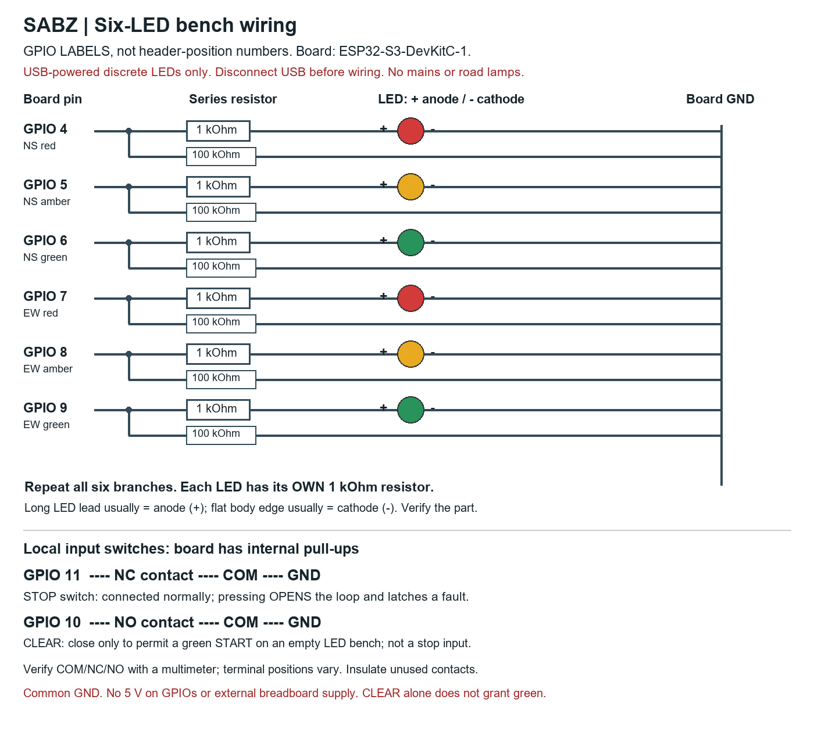

# First physical bench: shopping and assembly

Build: six discrete LEDs representing two compatible signal groups (NS and EW).
This verifies physical I/O for the development prototype. It is not a road-signal
installation or camera-accuracy test. No mains, road heads, relay boards or
external breadboard power supply are used in this first assembly.

## Shopping list

| Quantity | Exact part/specification | Notes for the seller |
|---|---|---|
| 1 | ESP32-S3-DevKitC-1, preferably Espressif N8R8, with soldered male headers | Ask for actual PCB/module photos and revision; GPIO 4..11 and GND must be exposed/labeled. Ordinary ESP32-WROOM-32, ESP32-CAM, C3 and S3-Zero are not substitutions |
| 2 each | Red, amber/yellow, green low-current diffused 5 mm LEDs | Six individual LEDs; not RGB, high-power heads or 5 V traffic-light modules |
| 6 | 1 kOhm, 1/4 W through-hole resistors | One series current-limiting resistor per LED; buy 10 for spares |
| 6 | 100 kOhm, 1/4 W through-hole resistors | One pull-down from each output GPIO to GND; buy 10 for spares |
| 1 | 830-point solderless breadboard | Board can remain OUTSIDE the breadboard so its wide headers do not block connection holes |
| 1 pack | Male-to-female jumper wires | Female sockets onto board's male headers; male ends into breadboard |
| 1 pack | Male-to-male breadboard jumpers | For LED/resistor nodes and the ground rail |
| 2 | Momentary SPDT switches with COM/NC/NO contacts | One stop input, one manual clearance input. Prefer prewired or screw-terminal versions; do not guess switch terminals |
| 1 | Data-capable USB cable matching the actual board connector | The official board uses a USB-to-UART connector; USB-C clones may differ. A charging-only cable will not program it |
| 1 | Digital multimeter with continuity and resistance modes | Required to identify switch contacts and check resistor values; borrow if available |
| As needed | Insulated base, labels, heat-shrink/terminal insulation | Keep bare header pins and unused switch contacts from touching metal |

For bare switch tabs or unsoldered headers, have an electronics technician attach
leads/headers before assembly. Breadboard jumpers do not make reliable contact
when loosely wrapped around tabs. One board GND rail is shared by all branches.
These are the two PHASE GROUPS, not six independently controlled traffic movements.

## Pakistan buying references checked 27 October 2026

These are listing references, not endorsements or verified delivery/stock quotes:

- [ESP32-S3-DevKitC-1 N8R8, Daraz/BURK listing](https://www.daraz.pk/products/esp32-s3-devkitc-1-n8r8-development-board-eu-version-i1954852143.html): page displayed Rs 9,783. Confirm actual model, headers, stock and final delivered price; marketplace title is not proof of authenticity.
- [Electronic Store listing](https://electronicstore.pk/product/esp32-s3-devkitc-1-n8r8-price-in-pakistan/): displayed Rs 1,500 but OUT OF STOCK. Do not plan around that price as an available offer.
- [830-point breadboard, EVE/eVision](https://www.evselectro.com/breadboards/mb-102-mb102-830-tie-points-breadboard-solderless-prototyping-project-board-7410): displayed Rs 300 and in-stock wording; reconfirm at purchase.
- [Three-pin lever-switch listing, Alpha Electronics](https://alphaelectronics.pk/product/small-micro-limit-switch-with-lever-actuator/): candidate only; seller must confirm COM/NC/NO and suitable connection leads.

A complete total has not been verified. Request a quote for the exact list rather
than buying a general starter kit with an unsuitable board. No order or message
to any seller has been sent.

The [Espressif board guide](https://documentation.espressif.com/esp-dev-kits/en/latest/esp32s3/esp32-s3-devkitc-1/user_guide_v1.1.html)
is the pinout/power reference. The firmware uses GPIO labels, NOT connector pin
positions. For example, header position 4 is not automatically GPIO4 on a
substitute board. Board revision/label matching comes before connecting wires.

## Assembly: power disconnected

1. Unplug every USB/power connection. Put the board on an insulated base outside
   the breadboard. Identify GND and the printed GPIO 4,5,6,7,8,9,10,11 labels.
2. Pick a breadboard rail for GND and connect it to a board GND pin. Check rail
   continuity: some boards split their power rails midway. Bridge only the GND
   sections needed. Do not connect the positive rail to 5V or 3V3.
3. Lay out two vertical red/amber/green LED groups, label them NS and EW. Put the
   two legs of every LED in electrically DIFFERENT rows. On a normal breadboard,
   holes within each small five-hole strip are internally connected.
4. Connect each LED cathode to GND. The cathode is normally the short lead/flat
   package edge; verify the actual LED, especially if its leads were cut.
5. For each LED, connect its anode through its OWN 1 kOhm resistor to the GPIO in
   the table below. Do not connect an LED directly to a GPIO.
6. For each output GPIO, also connect a 100 kOhm resistor from the GPIO-side node
   (BEFORE the 1 kOhm series resistor) to GND. This is a separate branch, not a
   replacement for the LED's current-limiting resistor.
7. With the switches disconnected and power OFF, use continuity mode to identify
   COM/NC/NO. COM-NC must conduct at rest and open when pressed. COM-NO must be
   open at rest and conduct when pressed. Contact positions vary by part.
8. STOP switch: COM to GND; NC to GPIO11; unused NO insulated. Keep the switch
   released during normal operation. Opening this circuit is treated as stop.
9. CLEAR switch: COM to GND; NO to GPIO10; unused NC insulated. Leave it open
   initially. It permits a green START and is not a stop switch; opening it
   during green does not directly terminate that green. Its deliberate closure
   means EMPTY LED BENCH, not proof of a
   clear real-world junction. The input uses an internal pull-up.
10. Verify the resistor values BEFORE inserting them, or lift one lead out of
    the circuit for measurement: about 1,000 ohms for each series resistor and
    100,000 ohms for each pull-down. In-circuit parallel paths can change readings. Recheck LED polarity, GND continuity and accidental row
    bridges before connecting power. If uncertain, have the wiring checked by an
    electronics technician before powering it.

| GPIO label | Connection |
|---|---|
| 4 | NS red through 1 kOhm |
| 5 | NS amber through 1 kOhm |
| 6 | NS green through 1 kOhm |
| 7 | EW red through 1 kOhm |
| 8 | EW amber through 1 kOhm |
| 9 | EW green through 1 kOhm |
| 10 | CLEAR switch NO; switch COM to GND |
| 11 | STOP switch NC; switch COM to GND |



## Flash and first power-up

The successfully built firmware package is
`data/firmware-release/sabz-esp32s3-low-voltage-bench.zip`.
Its build/firmware hashes are in `validation/esp32-rebuild-manifest.json`.
Do not use either existing Bluetooth COM3/COM4 port as the ESP32 port.

1. Flash with the LEDs initially disconnected if the board has not yet been
   programmed. Use its USB-to-UART connector and a data cable. Identify the NEW
   device port by comparing the port list before/after connecting the board:

```powershell
.\.venv-edge-test\Scripts\python.exe -m serial.tools.list_ports -v
```

2. From this repository, replace `ACTUAL_BOARD_PORT` deliberately:

```powershell
.\data\firmware-tools\arduino-cli.exe --config-file data/firmware-tools/arduino-cli.yaml upload --fqbn esp32:esp32:esp32s3 --port ACTUAL_BOARD_PORT --input-dir data/firmware-release/esp32s3_bench
```

This command writes board flash and resets it. It must only target the identified
low-voltage bench board. It has not been executed on hardware here.

3. Unplug USB again before attaching the completed LED assembly. Close the stop
   loop, leave clearance open, reconnect USB, and observe startup. Expected
   steady state is BOTH RED LEDs on, all amber/green off. Reset/boot transients
   remain unverified; unexpected outputs require disconnecting and investigating.
4. Closing CLEAR alone does not produce green. The host must also supply valid,
   fresh metric observations and clearance. No healthy real camera feed is
   attached automatically. The default `sabz_edge.server` still uses the emulator;
   use the explicit hardware-bench command in PHYSICAL_BENCH.md when ready.
5. If the stop circuit was open during boot, close it and locally reset after
   checking the cause. Stop faults latch; new camera packets cannot clear them.

Stop at this first power-up check if the displayed state differs. Record the
board/module label and actual port, then proceed with the timed, switch, lease
and readback acceptance tests in [PHYSICAL_BENCH.md](PHYSICAL_BENCH.md).

No camera, AI accelerator, Raspberry Pi, road relay or external power module is
needed for this first assembly. Camera/sensing validation is a separate stage.
If USB is the only power source, unplugging it makes LEDs dark; this is NOT a
power-independent traffic-signal fallback or road safety controller.
