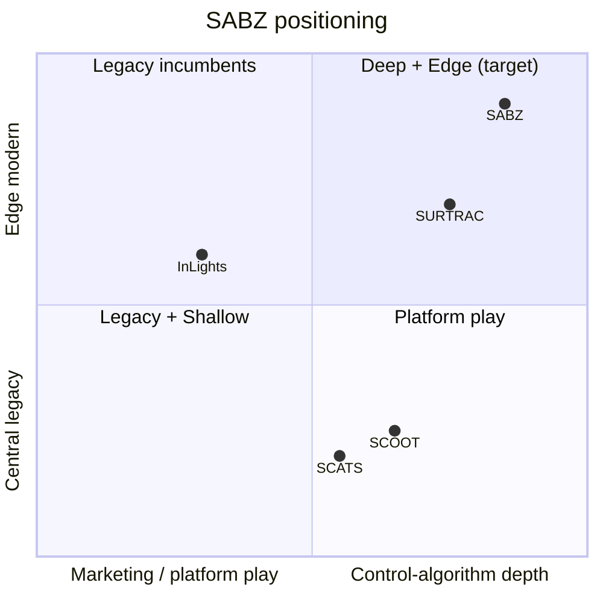

# SABZ competitor gap analysis

Research date: 2026. Sources: inlights.ai, Wikipedia articles on SCOOT, SCATS,
SURTRAC, plus `docs/DEPLOYED_SYSTEMS_RESEARCH.md` for deployment requirements.

## 1. Who we are benchmarked against

| System | Origin | Scale | Core method |
|---|---|---|---|
| **InLights** | Pakistan (Islamabad) | CDA, NUST, Capital Smart City deployments; PM endorsement | AI traffic + smart lighting + ANPR platform |
| **SCOOT** | UK, TRL 1979 | UK-wide; being replaced by TfL FUSION (500 sites by 2025/26) | Real-time split/cycle/offset optimization from loop demand; ~15% delay reduction vs fixed timing |
| **SCATS** | Australia, 1970s | 63,000+ intersections, 216 cities, 33 countries | Automatic plan selection from a library, degree-of-saturation control |
| **SURTRAC** | CMU, 2012 | 9+ intersections Pittsburgh pilot (East Liberty, Bakery Square) | Schedule-driven control (single-machine scheduling) + decentralized outflow messaging; −25% travel time, −40% wait |

## 2. Capability matrix — what each system has

| Capability | InLights | SCOOT | SCATS | SURTRAC | **SABZ (now)** |
|---|---|---|---|---|---|
| Adaptive per-intersection control | ✅ (claimed) | ✅ | ✅ plan selection | ✅ | ✅ max-pressure + batching |
| Corridor/network coordination | ❓ not documented | ✅ offsets | ✅ offsets | ✅ outflow messaging | ✅ supply hints + platoon-arrival boost |
| Max-pressure (academic gold baseline) | ❓ | ❌ | ❌ | ❌ (scheduling instead) | ✅ |
| Emergency preemption | ❓ | ✅ | ✅ | ❓ | ✅ |
| Transit signal priority | ❓ | ✅ | ✅ | ❓ | ✅ (bus green hold) |
| Pedestrian phases + accessibility timing | ❓ | ✅ | ✅ pushbuttons | ❓ | ✅ |
| Edge deployment (on-pole, no cloud) | ❓ (AI platform) | ❌ central | ❌ central | partial | ✅ designed for edge |
| Vision perception (phone-grade) | ✅ ANPR/cameras | ❌ loops | ❌ loops/radar | ✅ CCTV | ✅ (pending phone validation) |
| Live dashboard + alerts | ✅ platform | ✅ | ✅ | ✅ | ✅ |
| Emission/idle analytics | ❓ | ❌ | ❌ | ✅ claims | ✅ |
| Honest simulation benchmark harness | ❓ | ❌ | ❌ | pilot measurements only | ✅ conservation-checked, seeded |
| Formal safety kernel (conflict-free) | ❓ | vendor | vendor | ❓ | ✅ |
| RL/DQN research track | ❌ | ❌ | ❌ | ❌ | ✅ (blockers fixed) |

❓ = not documented publicly; InLights markets outcomes, not algorithms.

## 3. Where SABZ is genuinely ahead

1. **Max-pressure baseline.** Neither SCOOT, SCATS, nor SURTRAC uses
   max-pressure — the provably throughput-optimal discipline. We implement it
   with batching-aware green targets, fairness, and passage-gap protections.
2. **Coordination without a central master.** SCOOT/SCATS need a regional
   master plan; our coordination is decentralized (hints + platoon arrivals
   flow between neighbors), like SURTRAC — but with a tested pressure
   formulation (corridor benchmark: coordinated 25.45s vs independent 26.00s
   mean delay, 3 seeds).
3. **Edge-first + safety kernel.** Decisions at the pole, conflict-free
   phase interlocking proven by tests — a hard requirement for Pakistan's
   mixed traffic where detectors fail often.
4. **Honest evaluation.** Seeded, conservation-checked benchmarks with
   attribution (we measured that early-release green waves *hurt* and removed
   them). Competitors publish marketing numbers, not reproducible harnesses.
5. **Pakistan-native.** InLights is the local incumbent but is a platform
   company (traffic + lighting + ANPR). We are a control-algorithm company
   first — deeper on signal optimization, motorcycle/tuk-tuk perception
   classes, and cost-per-intersection.

## 4. Where competitors are ahead (our gaps)

| Gap | Who has it | What it takes | Status |
|---|---|---|---|
| Multi-intersection grid (not just 2-node corridor) | SCOOT/SCATS/SURTRAC | Generalize coordinator to N×M grids; test grid benchmarks | ✅ closed — grid coordinator + `test_grid.py` |
| Travel-time / probe feedback loop | SCOOT (offset optimization) | Corridor link travel estimation from release→arrival timestamps | ✅ closed — `Coordinator.tune_offsets` (bounded SCOOT-style EWMA) |
| Transit signal priority | SCOOT/SCATS | Bus detection + green extension policy | ✅ closed — TSP green hold in `core.py` + `test_tsp.py` |
| Decades of field tuning | SCOOT/SCATS | Real-road pilot — needs hardware | ⏳ pending hardware |
| Scale of deployment & brand | SCATS (63k), InLights (PM endorsement) | Pilot results, references | ⏳ pending pilot |
| ANPR / lighting integration | InLights | Optional add-on, not core | out of scope |

## 5. Strategic position

**Pitch in one line:** *SABZ is the only system combining the throughput-optimal
max-pressure discipline with decentralized corridor coordination, a proven
safety kernel, and edge deployment — at Pakistan price points, with a
reproducible benchmark instead of marketing claims.*

## 6. Priority order to close remaining gaps

1. ~~**Grid coordination**~~ ✅ done — N×M coordinator, grid benchmarks green.
2. ~~**Travel-time feedback**~~ ✅ done — `tune_offsets` closes the loop from
   observed link travel, bounded (≤4s/step, ≤40s from plan).
3. ~~**Transit signal priority**~~ ✅ done — bus detection holds green past
   min-green up to `tsp_extension_s`, safety exits always win.
4. **Phone validation** (blocked on user footage) — unlocks the vision claim.
5. **Real-road pilot** — the only thing that beats 63,000 SCATS intersections
   in credibility.